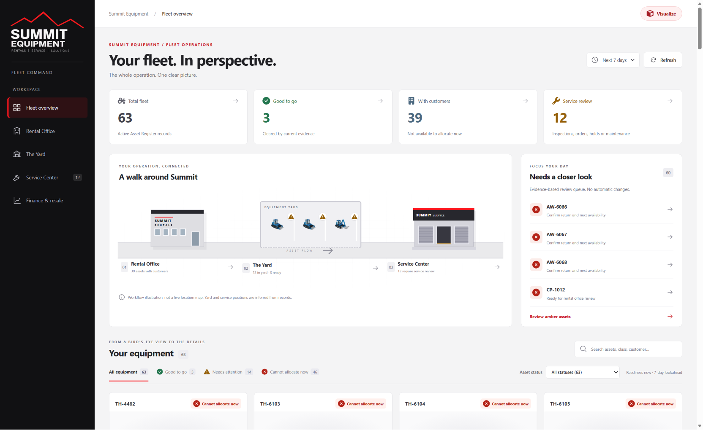
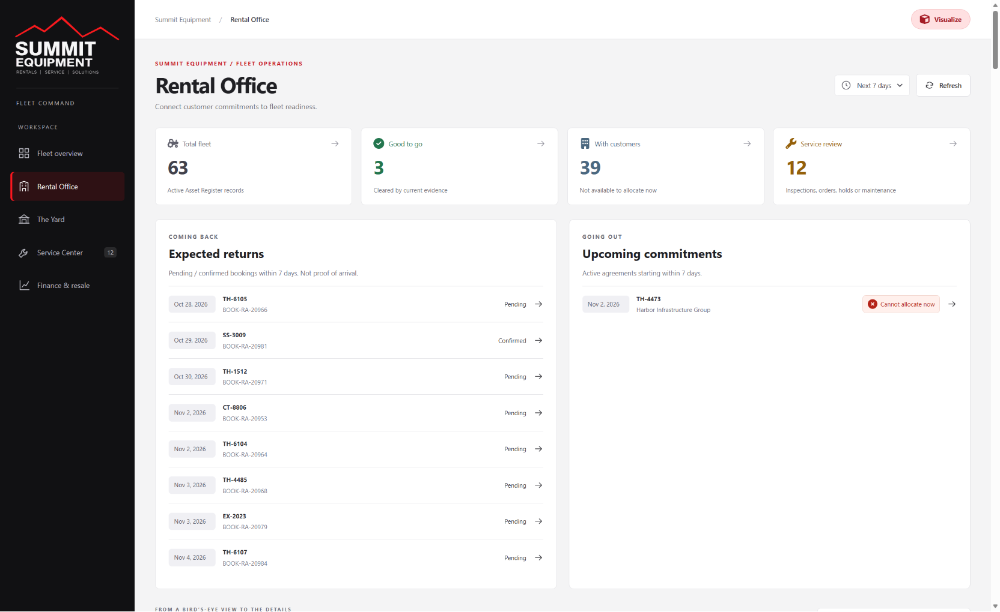
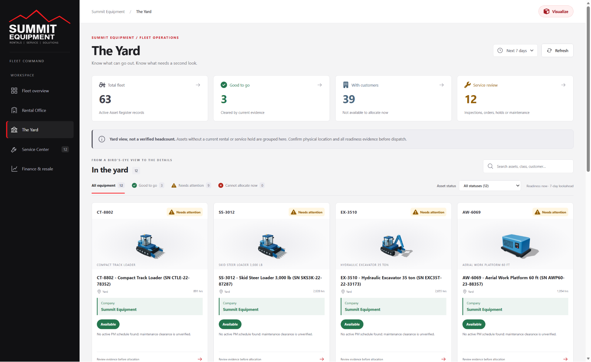
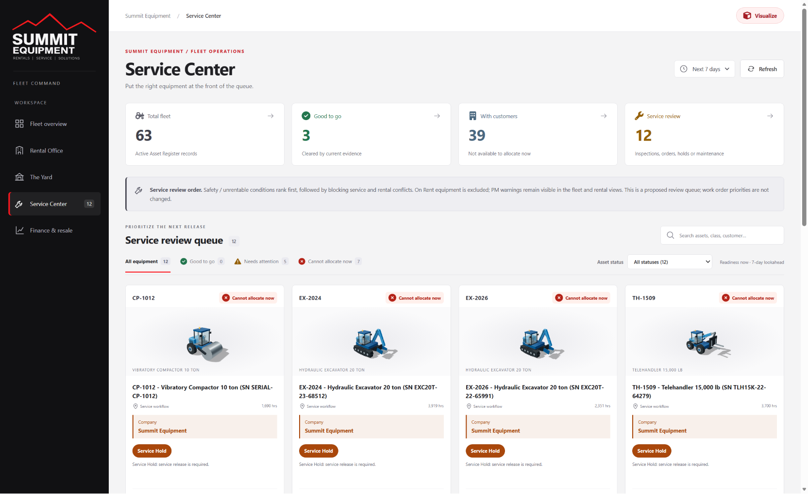
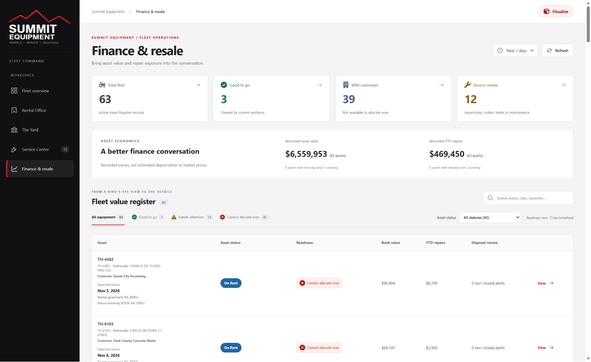
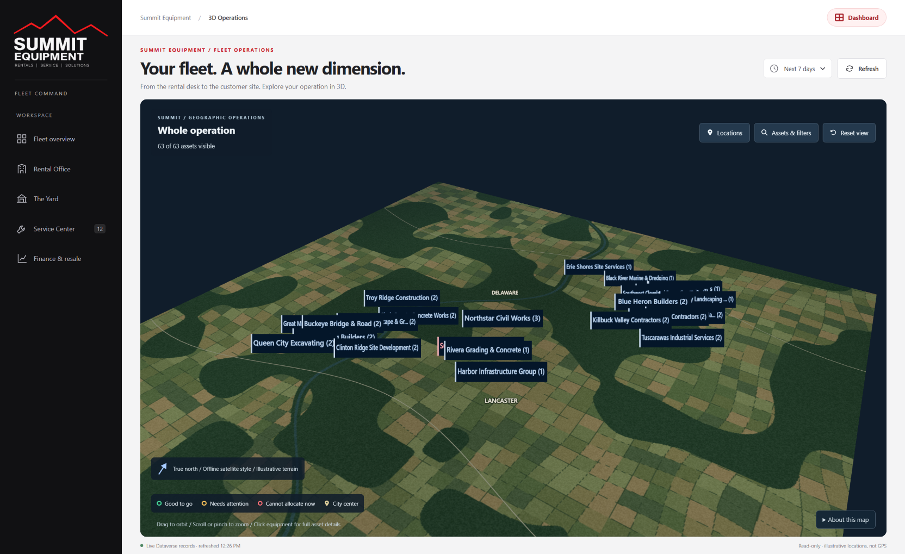
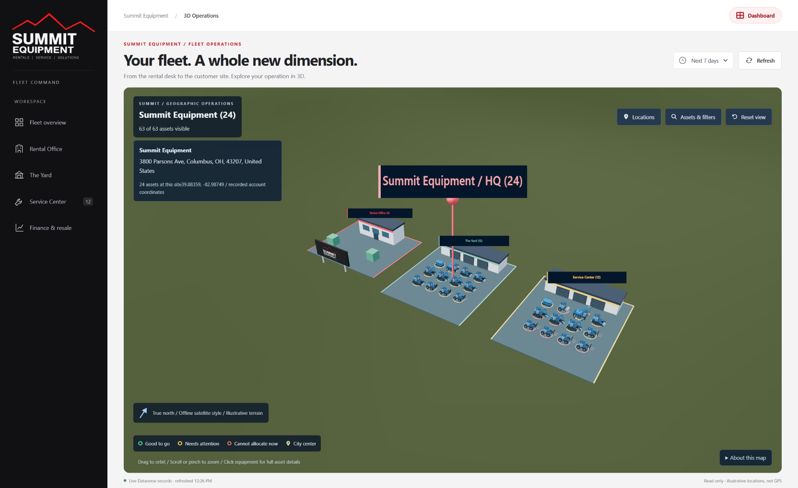

# Summit Fleet Command

**The whole operation. One clear picture.**

Summit Fleet Command brings equipment readiness, customer commitments, service
needs and asset economics into one workspace for fleet coordinators. Move from
a fleet-wide snapshot to the evidence behind an individual asset, or explore
the operation in an interactive 3D view.

## What you can do

- **Find equipment ready for the next job.** Search by asset, equipment class or
  customer, then combine readiness and recorded-status filters.
- **Plan ahead.** Switch between 7-, 14- and 30-day planning windows to surface
  upcoming rentals, expected returns and maintenance concerns.
- **Connect commitments to availability.** See which equipment is with customers,
  what is expected back and what needs to be ready for the next rental.
- **Focus service attention.** Review inspections, holds, maintenance and service
  conflicts alongside the evidence behind each concern.
- **Bring financial context into decisions.** Compare recorded book values,
  year-to-date repair costs and disposal alerts.
- **Explore the operation visually.** Navigate between company locations and
  inspect equipment in 3D without losing access to its operational details.

## A tour of the workspace

The screenshots below were captured from the running app on October 28, 2026.
Counts, dates and readiness reflect that snapshot and will change as records
and planning windows change.

### Fleet overview

Start the day with total fleet, ready-to-go equipment, assets with customers and
the service-review workload. The campus illustration links directly to the
Rental Office, Yard and Service Center, while **Needs a closer look** highlights
equipment that warrants attention.

Select a summary card to explore its equipment, or use search and filters to
narrow the fleet to the question you need to answer.

### Rental Office

Connect customer commitments to fleet readiness. Review expected return bookings
and upcoming agreement starts within the selected planning window, then open an
asset to understand its availability and any blockers.

Equipment with customers shows its current rental context. **Expected return**
comes from a return booking; **Ready by** highlights the next future rental
start for equipment not currently with a customer. Missing bookings and dates
are called out rather than guessed.

### The Yard

Review equipment grouped into the yard workflow and quickly distinguish what is
good to go from what needs another look. Equipment cards bring together class
illustrations, recorded status, calculated readiness, maintenance warnings and
the reasons behind the assessment.

Use the view to prepare a dispatch conversation, not as a substitute for
confirming physical location or completing release checks.

### Service Center

Focus on equipment needing inspection, service clearance or maintenance review.
The queue puts safety and unrentable-condition concerns first, followed by
blocking service and rental conflicts. Equipment still with customers is kept
out of this queue.

Open an asset to review work orders, preventive-maintenance thresholds, meter
readings and the latest recorded condition summary. Maintenance warnings
distinguish a verified meter overrun from overdue maintenance without sufficient
meter evidence.

### Finance & resale

Bring asset value and repair exposure into the same conversation as operational
readiness. Review recorded book value and year-to-date repairs, with totals
grouped by currency, then inspect individual assets and their disposal alerts.

These are recorded accounting figures, not estimated market prices. The app
does not invent depreciation, calculate resale valuations or automatically
recommend disposal.

### 3D Operations

Choose **Visualize** to explore the fleet across company locations. Orbit, zoom
and select sites to move from the regional picture to a closer view of the
operation.

- Use **Locations** to browse sites and mapping notices. Select **Summit Equipment**
  to see the Rental Office, Yard and Service Center with their assigned equipment.
- Open **Assets & filters** to search equipment and filter by readiness or status.
- Select equipment to open an inspector with operational evidence and a
  rotatable, class-specific equipment model.
- Use **Reset view** to return to the whole operation, or **Dashboard** to
  return to the main workspace.

The map uses recorded account coordinates with illustrative terrain. Equipment
placement is inferred from rental and service evidence, not live GPS tracking.
Equipment models represent classes, not actual asset photographs or digital
twins. Unresolved locations are identified rather than placed at guessed sites.

**Customer locations:** Start with the regional view to see the fleet across
customer sites.

**Summit Equipment HQ:** Select Summit Equipment to explore the Rental Office,
Yard and Service Center with their assigned equipment and readiness rings.

## Understand the readiness signals

Calculated readiness is shown separately from the asset's recorded status.
Labels and distinct icons accompany the colors so the meaning is not conveyed
by color alone.

| Signal | What it means |
| --- | --- |
| **Green - Good to go** | Available status with supporting maintenance and condition evidence, no current rental, and no blocking service or planning-window warning. |
| **Amber - Needs attention** | Evidence needs review, such as an inspection, missing information, due-soon maintenance, an upcoming commitment or a status discrepancy. |
| **Red - Cannot allocate now** | A current rental or another blocker prevents allocation, such as a service hold, unrentable condition, blocking work or maintenance at its meter threshold. |

Changing the planning window changes the lookahead warnings, not the recorded
asset status. A scheduled return is not proof of arrival, and completed-return
evidence does not automatically clear an unresolved On Rent status.

## From a signal to the supporting evidence

Open an equipment card or review-queue item to see the reasons behind its
readiness and suggested next action. Asset details bring together:

- Current customer and rental timing.
- Recorded locations, equipment identity and lifetime meter.
- Rental agreements and return bookings.
- Service work, preventive maintenance and recorded condition.
- Recorded book value, repair costs and disposal-review context.

Linked source records let coordinators continue their investigation in the
underlying business system.

## Designed to support decisions, not automate release

Fleet Command is a **read-only planning and review workspace**. It does not
change operational records, reprioritize work orders, dispatch equipment or
approve a release.

- Readiness is decision support, not a safety certification.
- Missing or conflicting evidence stays visible. If a connected source fails
  to load, readiness is unavailable rather than assuming equipment is safe.
- Yard and service groupings describe inferred workflows, not a verified
  physical headcount.
- Use **Refresh** to reload records; the app does not continuously stream changes.
- Confirm location, condition, maintenance and customer commitments before
  allocating equipment.

## Map data attribution

The 3D view includes a central Ohio city-center subset from the
[GeoNames cities5000 gazetteer](https://download.geonames.org/export/dump/),
extracted October 22, 2026, and licensed under
[Creative Commons Attribution 4.0](https://creativecommons.org/licenses/by/4.0/).
The app selects nearby city names and projects their coordinates into the scene.
The data is provided without warranty and is not survey-grade.

Terrain is independently generated and illustrative, not aerial photography or
verified street geometry. No external imagery or geocoding service receives
customer addresses or map bounds. Attribution is also available in
**About this map**.
